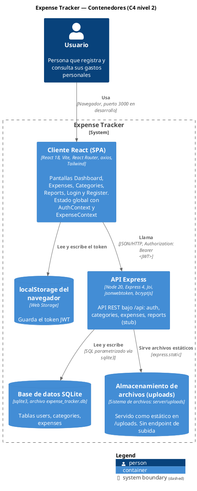
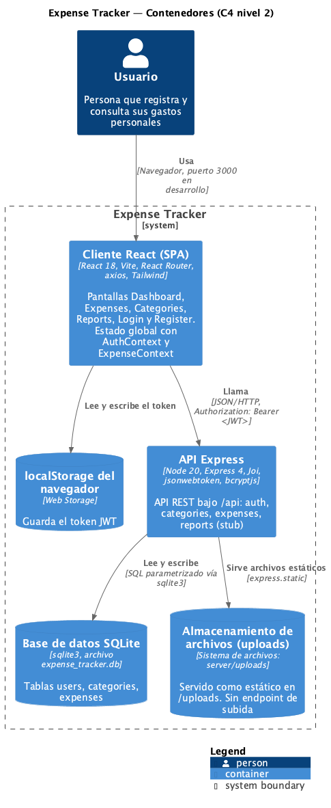

# C4 nivel 2 — Contenedores

> Fuente: `docs/context.md` y código en HEAD `56f3438`. Convenciones de `CLAUDE.md`: `[evidencia: ruta:línea]`, `[ASSUMPTION: motivo]`, `[NOT FOUND]`.
> Nombres compartidos con `c4-context.md` y `data-flow.md`: **Usuario**, **Expense Tracker**, **Cliente React (SPA)**, **localStorage del navegador**, **API Express**, **Base de datos SQLite**, **Almacenamiento de archivos (uploads)**.

> Imagen generada con `plantuml -tpng -o img docs/diagrams/*.md`. Si cambias el bloque PlantUML, vuelve a generarla.

## Elementos

| Elemento | Tipo C4 | Tecnología / detalle | Evidencia |
|---|---|---|---|
| Usuario | Person | Usa el cliente desde el navegador | [evidencia: client/index.html:10-11] |
| Expense Tracker | System Boundary | Monorepo con `client/` y `server/` orquestados por `concurrently` | [evidencia: package.json:7-9] |
| Cliente React (SPA) | Container | React + Vite; entrada `main.jsx` | [evidencia: client/package.json:7] [evidencia: client/src/main.jsx:7-13] |
| Cliente React (SPA) | Container | Rutas y providers `AuthProvider` → `ExpenseProvider` | [evidencia: client/src/App.jsx:15-44] |
| Cliente React (SPA) | Container | Dev server en el puerto 3000 con proxy `/api` → `localhost:3001` | [evidencia: client/vite.config.js:8-17] |
| localStorage del navegador | ContainerDb | Guarda el token tras login y registro | [evidencia: client/src/context/AuthContext.jsx:70] [evidencia: client/src/context/AuthContext.jsx:86] |
| localStorage del navegador | ContainerDb | El interceptor de axios lee el token y añade `Bearer` | [evidencia: client/src/services/api.js:13-20] |
| API Express | Container | App Express con CORS, morgan y JSON | [evidencia: server/src/app.js:8-16] |
| API Express | Container | Routers `/api/auth`, `/api/categories`, `/api/expenses`, `/api/reports` | [evidencia: server/src/app.js:31-34] |
| API Express | Container | Escucha en `PORT` o 3001 | [evidencia: server/server.js:6] [evidencia: server/server.js:13] |
| API Express | Container | Autenticación JWT en cada ruta de gastos | [evidencia: server/src/routes/expenses.js:7] |
| Base de datos SQLite | ContainerDb | Singleton `Database` sobre `sqlite3` | [evidencia: server/src/database/connection.js:1] [evidencia: server/src/database/connection.js:132-134] |
| Base de datos SQLite | ContainerDb | Ruta `SQLITE_DB_PATH` o `server/src/database/expense_tracker.db`; `:memory:` para pruebas | [evidencia: server/src/database/connection.js:7-16] |
| Base de datos SQLite | ContainerDb | Esquema `users`, `categories`, `expenses` | [evidencia: server/src/database/schema.sql:2-41] |
| Almacenamiento de archivos (uploads) | ContainerDb | `server/uploads` servido en `/uploads` | [evidencia: server/src/app.js:19] |
| Almacenamiento de archivos (uploads) | ContainerDb | Contenido ignorado por git salvo `.gitkeep` | [evidencia: .gitignore:35-36] |
| Almacenamiento de archivos (uploads) | ContainerDb | Columna `receipt_filename` que apuntaría al archivo | [evidencia: server/src/database/schema.sql:27-41] [evidencia: server/src/controllers/expenseController.js:15] |

## Relaciones

| Relación | Evidencia |
|---|---|
| Usuario → Cliente React (SPA) | [evidencia: client/vite.config.js:9-10] |
| Cliente React (SPA) → localStorage del navegador | [evidencia: client/src/services/api.js:15] [evidencia: client/src/services/api.js:32] |
| Cliente React (SPA) → API Express | Base `VITE_API_URL` o `http://localhost:3001/api` [evidencia: client/src/services/api.js:3-10] |
| API Express → Base de datos SQLite | La conexión se abre antes de `listen` [evidencia: server/server.js:11-13]; consultas con `run/get/all` [evidencia: server/src/database/connection.js:78-112] |
| API Express → Almacenamiento de archivos (uploads) | Solo lectura estática [evidencia: server/src/app.js:19]. La escritura (subida) es [NOT FOUND]: `multer` está instalado pero no se importa [evidencia: server/package.json:22-23] |

## Notas

- En producción, quién sirve el build del cliente (`client/dist`) es [NOT FOUND]: `npm start` solo arranca el server [evidencia: package.json:11] y `app.js` no sirve `client/dist` [evidencia: server/src/app.js:18-19].
- La configuración Knex/PostgreSQL de `server/src/config/database.js` no se usa, por eso no aparece como contenedor [evidencia: server/src/config/database.js:1-29].
