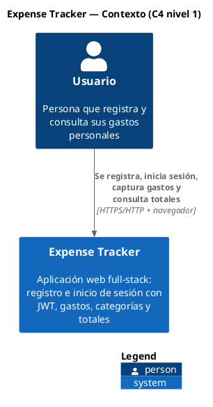
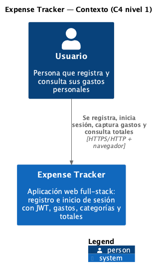

# C4 nivel 1 — Contexto del sistema

> Fuente: `docs/context.md` y código en HEAD `56f3438`. Convenciones de `CLAUDE.md`: `[evidencia: ruta:línea]`, `[ASSUMPTION: motivo]`, `[NOT FOUND]`.
> Nombres compartidos con `c4-container.md` y `data-flow.md`: **Usuario**, **Expense Tracker**.

> Imagen generada con `plantuml -tpng -o img docs/diagrams/*.md`. Si cambias el bloque PlantUML, vuelve a generarla.

## Elementos

| Elemento | Tipo C4 | Descripción | Evidencia |
|---|---|---|---|
| Usuario | Person | Se registra e inicia sesión | [evidencia: server/src/routes/auth.js:7-16] |
| Usuario | Person | Pantallas de Login y Register accesibles sin sesión | [evidencia: client/src/App.jsx:18-19] |
| Expense Tracker | Software System | Aplicación full-stack de control de gastos | [evidencia: package.json:4] |
| Expense Tracker | Software System | Gestión de gastos y categorías | [evidencia: server/src/routes/expenses.js:10-25] [evidencia: server/src/routes/categories.js:10-25] |
| Expense Tracker | Software System | Listado con totales y promedios | [evidencia: server/src/controllers/expenseController.js:78-92] |
| Usuario → Expense Tracker | Relación | El cliente llama a la API REST bajo `/api` | [evidencia: client/src/services/api.js:3-10] |

## Sistemas externos

| Buscado | Resultado |
|---|---|
| Proveedor de identidad externo (OAuth, SSO) | [NOT FOUND] — la autenticación es propia con JWT y bcrypt [evidencia: server/src/utils/auth.js:4-11] [evidencia: server/src/models/User.js:19-20] |
| Servicio de correo, pagos o almacenamiento en la nube | [NOT FOUND] — no hay URLs externas en `client/src`, `client/index.html`, `server/src` ni `server/server.js` (búsqueda con `grep` de `http(s)://` excluyendo `localhost`) |
| Base de datos administrada externa | [NOT FOUND] en uso — SQLite local [evidencia: server/src/database/connection.js:7-16]. `server/src/config/database.js` define PostgreSQL para producción, pero no se importa en ningún lado [evidencia: server/src/config/database.js:18] |

Por eso el diagrama no tiene sistemas externos: todo (cliente, API, base de datos y archivos) vive dentro de **Expense Tracker** y se detalla en `c4-container.md`.

## Notas

- Un solo tipo de usuario: no hay roles ni administración [ASSUMPTION: no se encontró campo de rol en `users`; ver esquema en server/src/database/schema.sql:2-10].
- El protocolo HTTPS no está configurado en el repo; en desarrollo es HTTP en `localhost` [evidencia: client/vite.config.js:9] [evidencia: server/server.js:6] [ASSUMPTION: en producción se usaría HTTPS delante del server].
