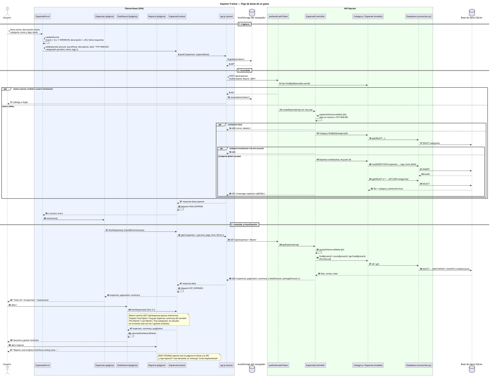
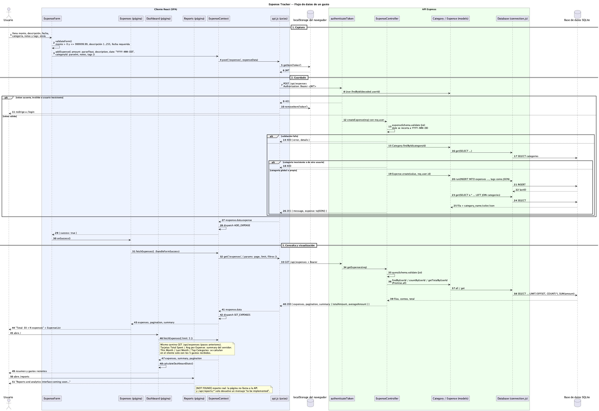

# Flujo de datos de un gasto

> Desde que se captura en el cliente hasta que se guarda y se muestra en un reporte.
> Fuente: `docs/context.md` y código en HEAD `56f3438`. Convenciones de `CLAUDE.md`: `[evidencia: ruta:línea]`, `[ASSUMPTION: motivo]`, `[NOT FOUND]`.
> Nombres compartidos con `c4-context.md` y `c4-container.md`: **Usuario**, **Cliente React (SPA)**, **localStorage del navegador**, **API Express**, **Base de datos SQLite**. Dentro de cada contenedor se muestran sus componentes (archivos reales).

**Importante:** la pantalla Reports y los endpoints `/api/reports/*` son stubs [evidencia: client/src/pages/Reports.jsx:10] [evidencia: server/src/routes/reports.js:5-26]. Hoy el gasto solo se "reporta" en la lista de Expenses (total y conteo) y en el Dashboard (tarjetas de resumen, mes actual/anterior, top categorías). El diagrama termina ahí y marca Reports como no implementado.

> Imagen generada con `plantuml -tpng -o img docs/diagrams/*.md`. Si cambias el bloque PlantUML, vuelve a generarla.

## Elementos

| Elemento | Contenedor | Rol en el flujo | Evidencia |
|---|---|---|---|
| Usuario | — | Captura el gasto y consulta resultados | [evidencia: client/src/pages/Expenses.jsx:78-84] |
| ExpenseForm | Cliente React (SPA) | Validación local | [evidencia: client/src/components/forms/ExpenseForm.jsx:41-71] |
| ExpenseForm | Cliente React (SPA) | Arma `expenseData` y llama a `addExpense` | [evidencia: client/src/components/forms/ExpenseForm.jsx:115-139] |
| ExpenseForm | Cliente React (SPA) | Fecha por defecto en `YYYY-MM-DD` | [evidencia: client/src/components/forms/ExpenseForm.jsx:9] |
| ExpenseContext | Cliente React (SPA) | `addExpense`: POST y `ADD_EXPENSE` | [evidencia: client/src/context/ExpenseContext.jsx:133-143] |
| ExpenseContext | Cliente React (SPA) | `fetchExpenses`: GET y `SET_EXPENSES` | [evidencia: client/src/context/ExpenseContext.jsx:108-131] |
| ExpenseContext | Cliente React (SPA) | Reducer guarda `expenses`, `pagination`, `summary` | [evidencia: client/src/context/ExpenseContext.jsx:39-64] |
| api.js (axios) | Cliente React (SPA) | Base URL e interceptor `Bearer` | [evidencia: client/src/services/api.js:3-20] |
| api.js (axios) | Cliente React (SPA) | 401 → borra token y redirige a `/login` | [evidencia: client/src/services/api.js:27-35] |
| localStorage del navegador | (contenedor propio) | Origen del token | [evidencia: client/src/services/api.js:15] |
| authenticateToken | API Express | Verifica JWT y carga `req.user`; 401 si falla | [evidencia: server/src/middleware/auth.js:4-25] |
| authenticateToken | API Express | Aplicado a todo el router de gastos | [evidencia: server/src/routes/expenses.js:7] |
| ExpenseController | API Express | `createExpense`: Joi + categoría permitida + 201 | [evidencia: server/src/controllers/expenseController.js:121-152] |
| ExpenseController | API Express | Esquema y recorte de fecha a `YYYY-MM-DD` | [evidencia: server/src/controllers/expenseController.js:5-18] |
| ExpenseController | API Express | `getExpenses`: filtros, paginación y `summary` | [evidencia: server/src/controllers/expenseController.js:42-92] |
| Category / Expense (models) | API Express | `Category.findById` para validar acceso | [evidencia: server/src/controllers/expenseController.js:132-140] |
| Category / Expense (models) | API Express | `Expense.create` (INSERT, tags como JSON) y relectura | [evidencia: server/src/models/Expense.js:28-45] |
| Category / Expense (models) | API Express | `findById` con `LEFT JOIN categories` | [evidencia: server/src/models/Expense.js:47-56] |
| Category / Expense (models) | API Express | `findByUserId` / `countByUserId` / `getTotalByUserId` | [evidencia: server/src/models/Expense.js:58-116] [evidencia: server/src/models/Expense.js:118-119] [evidencia: server/src/models/Expense.js:149-152] |
| Category / Expense (models) | API Express | `toJSON` en camelCase con `category` | [evidencia: server/src/models/Expense.js:209-224] |
| Database (connection.js) | API Express | Envoltorios con promesas `run/get/all` | [evidencia: server/src/database/connection.js:78-112] |
| Base de datos SQLite | (contenedor propio) | Tabla `expenses` | [evidencia: server/src/database/schema.sql:27-41] |
| Expenses (página) | Cliente React (SPA) | `handleFormSuccess` refresca la lista | [evidencia: client/src/pages/Expenses.jsx:53-57] |
| Expenses (página) | Cliente React (SPA) | Muestra total y conteo | [evidencia: client/src/pages/Expenses.jsx:73-75] |
| Dashboard (página) | Cliente React (SPA) | Pide solo 5 gastos | [evidencia: client/src/pages/Dashboard.jsx:25] |
| Dashboard (página) | Cliente React (SPA) | Calcula mes actual/anterior y top categorías en el cliente | [evidencia: client/src/pages/Dashboard.jsx:36-90] |
| Dashboard (página) | Cliente React (SPA) | Tarjetas con `summary` del servidor | [evidencia: client/src/pages/Dashboard.jsx:140] [evidencia: client/src/pages/Dashboard.jsx:186] |
| Reports (página) | Cliente React (SPA) | Stub "coming soon" | [evidencia: client/src/pages/Reports.jsx:10] |
| `/api/reports/*` | API Express | Stubs con `TODO` | [evidencia: server/src/routes/reports.js:5-26] |

## Observaciones del flujo

- **Dashboard con datos parciales:** "This Month", "Last Month" y "Top Categories" se calculan sobre los 5 gastos que pide el Dashboard, no sobre todos [evidencia: client/src/pages/Dashboard.jsx:25] [evidencia: client/src/pages/Dashboard.jsx:44-75]. En cambio, "Total Spent" y "Avg per Expense" usan el `summary` del servidor, que cubre todos los gastos del usuario [evidencia: server/src/controllers/expenseController.js:70-74]. [ASSUMPTION: probablemente no es intencional; no se encontró documentación que lo explique].
- **Archivos adjuntos:** el formulario no envía `receiptFilename` [evidencia: client/src/components/forms/ExpenseForm.jsx:126-133], así que en este flujo no interviene **Almacenamiento de archivos (uploads)**.
- **URL de la API:** sin `VITE_API_URL`, axios llama directo a `http://localhost:3001/api` y no usa el proxy de Vite [evidencia: client/src/services/api.js:3] [evidencia: client/vite.config.js:11-16].
